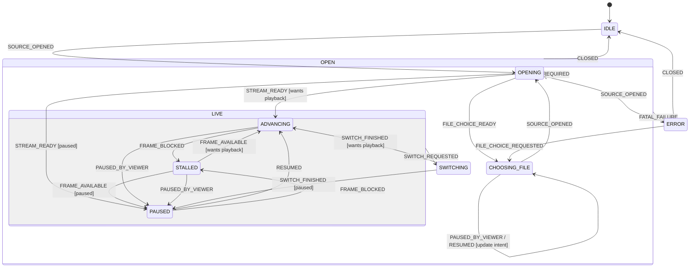

# The application state machine

The design and the graph of the machine in `public/domain/app-state.js`
(tested by `test/app-state.test.js`). This file changes in the same commit as
`app-state.js` whenever an edge, a state or a view moves (`AGENTS.md`). The
machine it replaced (server 0.8.119) and the hazards H1-H5 found in it are kept
in meta
[`research/state-machine-2026-08-08.md`](https://github.com/torrent-tv/meta/blob/main/research/state-machine-2026-08-08.md),
Part 2.

## What it is derived from

Stated as a project rule 2026-08-08: architectural decisions come from theory,
not from what the code happens to do. Four principles decide everything below.

1. **Moore machine** — outputs depend on the state alone, never on the edge
   taken. So the view, the overlay and whether the controls are live are *pure
   functions of the state*, derived by each view, never commanded alongside a
   transition. In the machine this one replaced they were commanded
   (`LOADING:SHOW`, `PLAYER:SHOW`, `ERROR:SHOW`), which is why state and screen
   could disagree — and in four places they did.
2. **Extended state machine** — promote something to a control state only when
   it changes what is legal or what is shown. Everything else stays a variable
   with guards. This is what stops the Cartesian explosion: N independent
   booleans as states would need 2^N of them. Never mirror another component's
   state (`<video>.paused`) as a state.
3. **Statechart hierarchy (Harel)** — an edge shared by several states is
   declared once on their superstate. In the replaced machine `-> IDLE` and
   `-> ERROR` were each written three times.
4. **The transition relation is a graph** — it must be deterministic (one target
   per state and event), total (every pair answered, including "ignore", never
   a throw), have every state reachable and no dead ends. And the edges that
   are ABSENT are the machine's real content: a near-complete digraph asserts
   nothing, which is what the replaced table had become.

## The machine

| state | means | reached by |
|---|---|---|
| IDLE | no source open | start, or closing one |
| CHOOSING_FILE | a source is open, nothing is being built, the viewer is picking a file | a multi-file source is listed, or "Back to episodes" from the error screen |
| OPENING | source open, no playable stream yet | cold open; rebuild after an audio switch, a reconnect, or a Retry |
| STALLED | a frame is wanted now and is not available | a seek into data that is not here, a scrub while paused, starvation mid-playback. NOT every `waiting` the element reports — see below |
| ADVANCING | the picture is moving | enough media buffered |
| SWITCHING | the viewer asked for a change and the picture is held until it is ready | picking a soundtrack that is published as its own rendition (server 0.24.2); a seek, until the proxy forecasts it can play on from there (server 0.50.10, torrent-tv/meta#178) |
| PAUSED | the viewer stopped playback; no frame is wanted | the element's own `pause`, when it was not one of ours |
| ERROR | unrecoverable | a failure the pipeline declares fatal |

Superstates: `OPEN = {CHOOSING_FILE, OPENING} ∪ LIVE` — a source is open.
`LIVE = {ADVANCING, STALLED, SWITCHING, PAUSED}` — a stream exists.

`{OPENING, STALLED, SWITCHING}` is NOT a superstate — `OPENING` sits outside
`LIVE` and the other two inside it, so they do not nest. It is a predicate over
states, which is what an output is.

## SWITCHING — the hold, and why it is a state (server 0.24.2)

**A seek takes the same hold (server 0.50.10, torrent-tv/meta#178).** The first
start waits for the proxy's continuity forecast (`playbackReadiness`); a seek
did not, and `seeked` let the element play on with the first segment that
arrived — field r28: back to 100 s with 4 s buffered, a stop of 3.35 s at
116 s. Now `#moveToPosition` raises `SWITCH_REQUESTED` as the seek begins,
`FRAME_AVAILABLE` changes nothing in `SWITCHING`, and `SWITCH_FINISHED` comes
when the forecast for the position the proxy was told of is ready. Who holds the
picture is one set of owners (`domain/picture-holds.js`): the audio pick and
the latest seek; the picture moves again only when none holds it, and a later
seek takes the hold over so an earlier seek's answer releases nothing. No edge
was added or removed.

Reported 2026-09-03: choosing an external soundtrack stopped the picture, the
viewer could press play and watch on in the old language, and the new one then
arrived without warning.

Read out of the code, the whole of it followed from one line. The pipeline
stopped the element with a plain `video.pause()` — not `pauseWithoutIntent`,
which is the one thing separating our own pause from the viewer's — so the
`pause` event was reported as `PAUSED_BY_VIEWER` and the machine went to
`PAUSED`. Everything the viewer saw follows from that state and from nothing
else: the overlay is not shown in `PAUSED` (`isWaiting`), so the spinner
switched on a line earlier went straight off again; the play control is live in
`PAUSED`, so playback resumed; and the pipeline, holding a position and a "was
playing" flag of its own, restored both when the track landed — the jump the
report calls sudden.

So the wait had no state and was imitated with an output. Under the second rule
here that is exactly the case for promoting one: it changes what is shown (the
overlay) and what is legal (the play control refuses input), and neither is true
of `PAUSED` or of `STALLED`.

Three things fall out of having the state, and each replaces something the
pipeline was doing by hand:

- the pause is issued by the player from `mediaIntentForState` and marked as
  ours, so `viewerWantsPlayback` still carries the viewer's own last decision —
  which is what the guard on `SWITCH_FINISHED` reads to decide whether the
  picture starts again by itself. The pipeline's own `wasPlaying` is gone.
- the position is never restored, because it never moved: the picture is held
  rather than left running. The pipeline's own `resumeAt` is gone.
- a second pick during a hold is the self-transition on `LIVE`. No output moves;
  the pipeline abandons the earlier pick and waits for the new one.

`SWITCH_REQUESTED` sits on `LIVE` and not on `OPEN`. A pick needs a stream to
change and `OPENING` has none: sent there it would hold a picture that is not
running and then release it into a state the build had already left.

The play control is refused through every way there is of starting a picture —
the button's `disabled`, the controller's `nohotkeys`, its `gesturesdisabled`,
and a `play` on the element answered with a pause of ours. The first three are
what a viewer meets; the fourth is the guarantee, for a remote control, a media
key or a script.

The time range is deliberately untouched, and so is picking another track:
both are what the viewer asked to keep during the wait. (There was a quality
menu here too; since server 0.29.0 the quality is always automatic and the page
has no quality control — roadmap item 98.)

## What `FRAME_BLOCKED` is derived from (server 0.12.3)

The element reports `waiting` for two conditions that need opposite answers, so
the event is not raised from it directly. `public/domain/waiting-signal.js`
decides, and it is a pure function with its own tests:

| the element says | the picture | verdict |
|---|---|---|
| waiting, not seeking, position unchanged | stopped | STALLED — the viewer is told |
| waiting, not seeking, position advanced | running | no event: some OTHER track is being refilled |
| seeking | irrelevant | STALLED — a seek is a wait the viewer made |

The second row is a separately published audio track being changed: the player
discards the audio it holds and refetches it from where the picture is, which
took 2.75 s measured on the addon host while the picture never stopped. Reported
as a stall it puts a spinner over moving video.

What was tried first and is wrong, recorded so it is not tried again: a grace
window of four seconds after a track change. `waiting` fires on a TRANSITION, so
a stall beginning inside the window is swallowed and never reported at all —
the element, already waiting, never fires it again. A window also swallows a
seek made in the same seconds. Movement of the picture separates the two cases
without a clock.

## Outputs, as functions of the state

| output | rule |
|---|---|
| view | IDLE → picker, ERROR → error screen, OPEN → player |
| waiting overlay | state ∈ {OPENING, STALLED, SWITCHING} |
| what to tell the element | ADVANCING → play, OPENING/STALLED → touch nothing, otherwise → pause |
| play control accepts input | every state except SWITCHING |

This is what settles the question asked three times — **is a seek "processing"?**
Yes. It is `STALLED`, and `isWaiting` is true for it exactly as for `OPENING`,
so the two produce byte-for-byte the same output. The earlier answer, that waiting is "a condition and not a
state", was defending the existing code rather than applying anything: same
output with different legal behaviour is exactly what a superstate with two
substates is for. Same overlay, and yet Cancel means "abandon the load" in one
and nothing in the other, a failure is fatal in one and retried in the other,
and only one of them has a position worth keeping.

## Extended state — deliberately NOT states

`videoCount` (guards which buttons the error screen offers), the resume position,
the playback epoch, `viewerWantsPlayback`, and — since proxy 2.13.0 / server
0.10.0 — the rungs the proxy is currently willing to serve, with the viewer's
forced pick among them.

That last pair is checked against the rules rather than assumed to belong here.
The list arrives with the playback plan and is restated in every progress
report, so it changes many times within one state; since server 0.29.0 it
changes no output at all (the quality menu is gone, roadmap item 98), and
nothing about which transitions are legal depends on it. A rung being withdrawn
while the viewer watches another one is therefore a variable changing, not an
event. A change of quality never rebuilds the stream any more: the proxy asks
for a rung and the player moves between variants within LIVE. Promoting it to a
control state would add a state that shows nothing new.

That last one was nearly the undoing of the whole change. It was read as
`!video.paused`, which is "is it stopped right now" and not "did the VIEWER stop
it" — and the pre-buffer gate pauses the element deliberately one line before a
stream is announced ready. So every cold open reported "the viewer does not want
playback" and ended stopped on its first frame. The two facts are now separated
in `domain/playback-intent.js`: a pause we cause is marked as ours before it is
issued, and only an unmarked one counts as the viewer's.

The element also pauses ITSELF when it fails (field 2026-10-04: `error` at
1189.2 s, `pause` 12 ms later). Read as the viewer's, that pause moved the
machine to PAUSED and nothing started the picture once the player had been
rebuilt (torrent-tv/meta#116). Since then a pause has one of three causes —
ours, the element's, the viewer's — and only the last is `PAUSED_BY_VIEWER`. A
failure is a stall: the frame is wanted and is not there, so it is
`FRAME_BLOCKED`, and the end of the stall carries `viewerWantsPlayback` as the
viewer's own last decision rather than `!video.paused`, which is false after a
failure whether or not the viewer stopped anything.

PAUSED did become a state, against the first draft. The test that decides it is
Moore's: pause changes an output (what the element is told), and an output that
differs must have a state that differs. What is NOT mirrored is the element's own
`paused` flag as a source of truth — the machine enters PAUSED from the element's
event and never decides it.

## What the absent edges assert

- No `IDLE -> ADVANCING`: nothing plays that was not built first.
- No `IDLE -> ERROR`: a failure needs an open source. The replaced machine had
  this edge, reachable only through a late event from an abandoned attempt (H4).
- No `IDLE -> STALLED`: a stall presupposes a stream.
- No `SWITCHING -> ADVANCING` on `RESUMED`, and no `SWITCHING -> PAUSED` on
  `PAUSED_BY_VIEWER`: nothing the element says lifts a hold the viewer asked
  for, only the change finishing does. This is the defect of 2026-09-03 written
  as an edge that must not exist — a play that gets past the refused control
  must not become the machine's decision.
- No `SWITCHING -> STALLED`: a wait the viewer asked for is not starvation, and
  the two must not be counted as one — the stall total is what the cushion is
  judged by.
- No `ERROR -> ADVANCING`: the old `BACK_TO_PLAYLIST` took it, claiming a file
  could start advancing without being opened. It is now
  `ERROR -> CHOOSING_FILE`, because returning to the CHOICE is not opening a
  file: sent as `SOURCE_OPENED` it claimed a build nobody had started, and the
  modal waiting view came up over the episode list carrying the failed file's
  name.

Each edge now says something, and the four invariants above are executed by the
tests rather than left as prose — `ABSENT_EDGE_INVARIANTS` is data.
